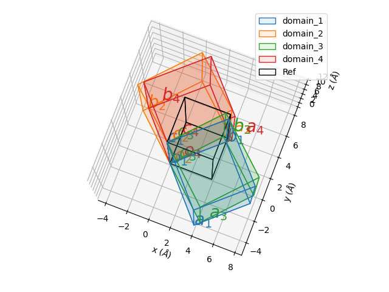
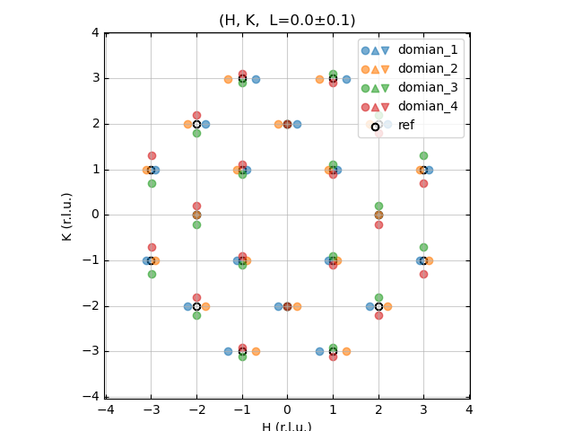
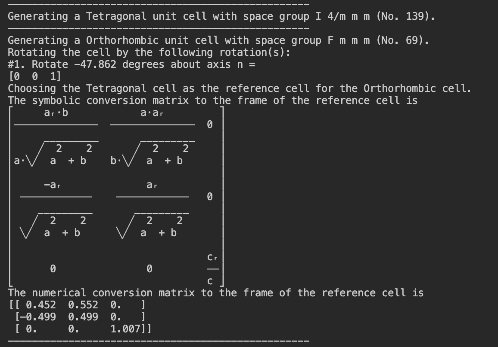
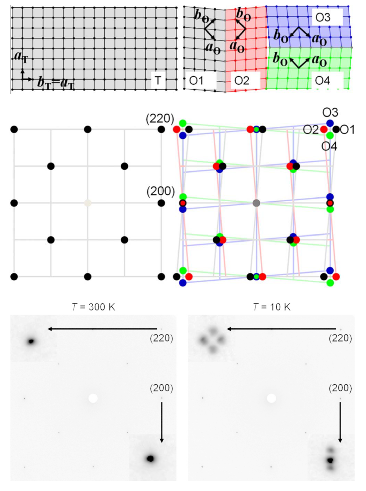

[](https://github.com/bingli621/TwinIndex/actions/workflows/tests.yml)

TwinIndex provides the simulation and symbolic calculation of the scattering pattern when the unit cell distorts and creates twin domains.

## Installation

TwinIndex uses [pixi](https://pixi.sh) to manage its environment. All dependencies (numpy, sympy, matplotlib and cctbx-base) are installed from conda-forge.
TwinIndex uses the cctbx-base package in the Computational Crystallography Toolbox (cctbx) for the calculation of the systematic absence of the given space group. For details of cctbx, see https://cci.lbl.gov/docs/cctbx/.

1. Install pixi, see https://pixi.sh/latest/#installation
2. Clone this repository and install the environment:

```
git clone https://github.com/bingli621/TwinIndex.git
cd TwinIndex
pixi install
```

## Usage

```python
import matplotlib.pyplot as plt
from twinindex import Cell, Domains

cell = Cell(spgr="P21/c", lattice_params=(9.185, 5.8294, 7.9552, 100.79))
domains = Domains(cell)
domains.make_twin_mirror(plane=[1, 0, 0], origin=[-1, -1, -1])
domains.plot_domains()
domains.plot_peaks(projection="H,0,L", del_Q=0.1, d_min=1)
plt.show()
```

Run your own script with `pixi run python your_script.py`, or activate the environment with `pixi shell`.

## Tutorials

The tutorials are in [examples/](examples/), and each can be run as a pixi task:

```
pixi run cell-definition    # examples/0_cell_definition.py
pixi run cell-distortion    # examples/1_cell_distortion.py
pixi run twin-domains       # examples/2_twin_domains.py
pixi run cafe2as2           # examples/3_distortion_and_domains_in_CaFe2As2.py
```

## Project layout

```
src/twinindex/    the package (Cell, Domains)
examples/         tutorial scripts
tests/            test suite, run with `pixi run test`
docs/images/      figures used in this README
```

## Example

Tutorial 3 gives an example of in the case of CaFe2As2




Output of tutorial 3.


PHYSICAL REVIEW B 79, 180508(R) (2009)


