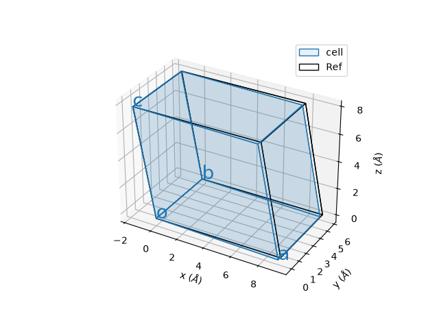
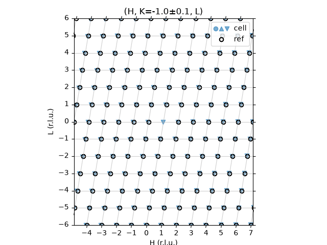
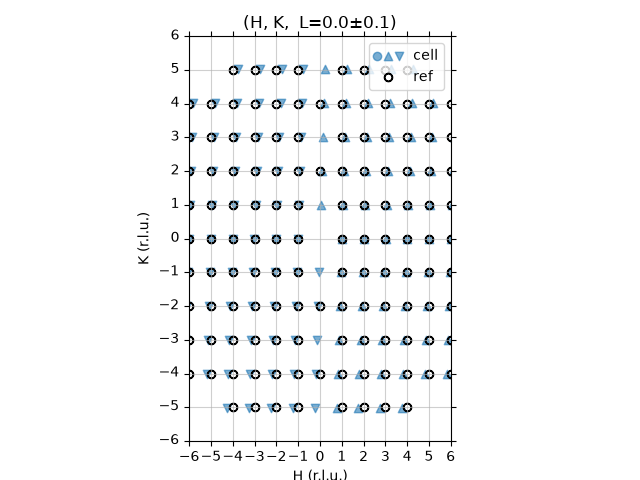
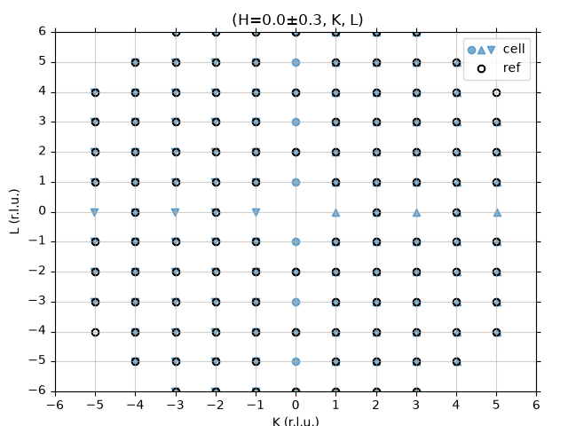
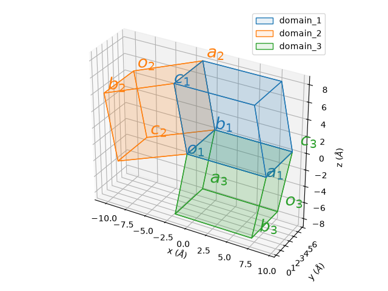
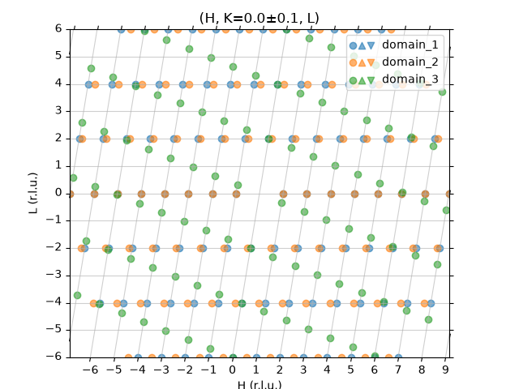
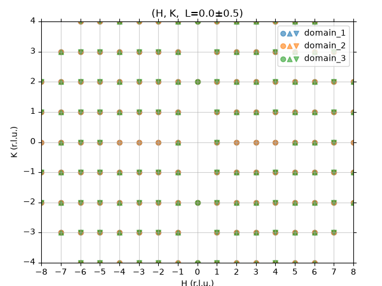
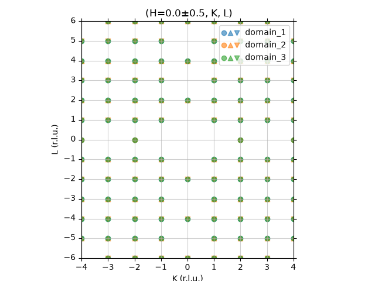

[](https://github.com/bingli621/TwinIndex/actions/workflows/tests.yml)

TwinIndex provides the simulation and symbolic calculation of the scattering pattern when the unit cell distorts and creates twin domains.

## Installation

TwinIndex uses [pixi](https://pixi.sh) to manage its environment. All dependencies (numpy, sympy, matplotlib and cctbx-base) are installed from conda-forge.
TwinIndex uses the cctbx-base package in the Computational Crystallography Toolbox (cctbx) for the calculation of the systematic absence of the given space group. For details of cctbx, see https://cci.lbl.gov/docs/cctbx/.

1. Install pixi, see https://pixi.sh/latest/#installation
2. Clone this repository and install the environment:

```
git clone https://github.com/bingli621/TwinIndex.git
cd TwinIndex
pixi install
```

## Usage

```python
import matplotlib.pyplot as plt
from twinindex import Cell, Domains

cell = Cell(spgr="P21/c", lattice_params=(9.185, 5.8294, 7.9552, 100.79))
domains = Domains(cell)
domains.make_twin_mirror(plane=[1, 0, 0], origin=[-1, -1, -1])
domains.plot_domains()
domains.plot_peaks(projection="H,0,L", del_Q=0.1, d_min=1)
plt.show()
```

Run your own script with `pixi run python your_script.py`, or activate the environment with `pixi shell`.

## Key concepts

**Cell.** `Cell(spgr, lattice_params)` builds a unit cell from a space group symbol (e.g. `"P21/c"`, `"I4/mmm"`) and its lattice parameters, in Å and degrees. Only the free parameters of the crystal system are needed, though all six are also accepted:

| Crystal system | `lattice_params` |
|---|---|
| Cubic | `(a,)` |
| Tetragonal, Hexagonal | `(a, c)` |
| Orthorhombic | `(a, b, c)` |
| Monoclinic | `(a, b, c, beta)` |
| Triclinic | `(a, b, c, alpha, beta, gamma)` |

**Symbolic variables.** Every new cell gets its own symbols, numbered in order of creation: the first cell has `a₁, b₁, c₁, β₁`, the second `a₂, b₂, …`. Results such as rotation angles and index conversion matrices can be printed as formulas in these symbols, and every number shown is obtained by substituting the lattice parameters. For monoclinic and triclinic cells, an angle given as an integer (e.g. `90`) is treated as exact and fixed. An angle given as a float (e.g. `90.0` or `101.00`) becomes a symbol.

**Orientation.** A new cell is placed with **a** along x, **b** in the xy-plane and **c** completing the cell. `cell.rotate_cell(rot_angles, rot_axes)` rotates it counter-clockwise, in degrees, about one or more axes in turn; rotations accumulate across calls. Angles can be numbers or sympy expressions in the cell symbols. Axes can be Cartesian vectors such as `[0, 0, 1]` or lattice vectors such as `cell.a_vec`. Setting `cell.origin` only moves where the cell is drawn.

**Reference cell.** `cell.make_as_reference(cell_ref)` chooses the cell whose reciprocal lattice defines the (H, K, L) axes of the peak plots. TwinIndex computes the matrix *P* that converts Miller indices of `cell` into reciprocal lattice units (r.l.u.) of `cell_ref`, *P* = (**a**\*<sub>ref</sub> **b**\*<sub>ref</sub> **c**\*<sub>ref</sub>)<sup>−1</sup> (**a**\* **b**\* **c**\*), and prints it. With `SYMBOL=True` it also prints *P* as a formula. Use this to compare a distorted (low-symmetry) cell with the undistorted (high-symmetry) one.

**Twin domains.** `Domains(cell)` starts a list of domains with `cell` as domain 1. Each new domain is a copy of that cell, rotated by any rotations already applied to it, plus one of:

- `make_twin_rotation(rot_angles, rot_axes)`: further rotations, in degrees, about the given axes.
- `make_twin_mirror(plane=[h, k, l])`: mirroring across the (h k l) plane. This is done as a 180° rotation about the plane normal, which gives the same Bragg peak positions as a true mirror (they differ only by an inversion).

`origin=[h, k, l]` moves where the new domain is drawn to h**a** + k**b** + l**c**, so the domains don't overlap in the 3D plot. The domains are compared in the frame of the original cell's reference cell or, if it has none, in the frame of domain 1.

**Peak plots.** `plot_peaks(projection, del_Q, d_min)` draws the Bragg peaks in one reciprocal-lattice plane:

- `projection` names the plane: the two letters are the in-plane axes and the number fixes the third index. For example, `"H,K,0"` is the L = 0 plane and `"H,-1,L"` is the K = −1 plane.
- `del_Q` is the slab half-thickness, in r.l.u. of the third index. ● marks a peak exactly in the plane, ▲ one up to `del_Q` above it and ▼ one up to `del_Q` below it. A distorted cell or twin domain often puts peaks slightly off the plane of the reference cell, so a ▲ or ▼ shows that distortion.
- `d_min` is the smallest d-spacing, in Å, of the peaks generated. Peaks are generated with [cctbx](https://cci.lbl.gov/docs/cctbx/), so peaks forbidden by the space group's systematic absences are left out.
- Peaks of the reference cell are drawn as black rings ◯. The grid is skewed to follow the true angle between the two reciprocal axes, so a peak sits at its real position in the plane.

`plot_cell()` and `plot_domains()` draw the unit cells in 3D. The reference cell, when one is set, is drawn as a black outline.

## Tutorials

The tutorials are in [examples/](examples/). Each can be run as a pixi task, which prints the steps and matrices to the terminal and opens the figures:

```
pixi run cell-definition    # examples/0_cell_definition.py
pixi run cell-distortion    # examples/1_cell_distortion.py
pixi run twin-domains       # examples/2_twin_domains.py
pixi run cafe2as2           # examples/3_distortion_and_domains_in_CaFe2As2.py
```

### Example 0: defining and orienting a cell

[0_cell_definition.py](examples/0_cell_definition.py) shows the basic `Cell` operations on a monoclinic P2<sub>1</sub>/c cell (a = 9.185 Å, b = 5.8294 Å, c = 7.9552 Å, β = 100.79°):

1. Create the cell and draw it in its default orientation.
2. Rotate it by 90° about **a**.
3. Rotate it by 90° about **a**, then by 90° about **b**. These rotations add to the first one. The axes are read from `cell.a_vec` and `cell.b_vec` at the time of the call, so they are the already-rotated lattice vectors.
4. Set `cell.origin = -cell.c_vec` to draw the cell shifted by −**c**.
5. Create a second, triclinic P-1 cell. It is cell #2, so its symbols are `a₂, b₂, …`.

### Example 1: a cell distortion

[1_cell_distortion.py](examples/1_cell_distortion.py) simulates a monoclinic-to-triclinic transition: a high-temperature P2<sub>1</sub>/c cell (#1) distorts on cooling into a low-temperature P-1 cell (#2) with a = 9.1614 Å, b = 5.8075 Å, c = 7.9584 Å, α = 90°, β = 101.00°, γ = 91.76°. The script answers the question: where do the low-temperature peaks appear, in the indices of the high-temperature cell?

1. **Create both cells.** α is given as the integer `90`, so it stays exactly 90°. β and γ are floats, so they become the symbols β₂ and γ₂.
2. **Align the cells.** In the default orientation, the triclinic **b** is γ₂ = 91.76° from x, while the monoclinic **b** is along y. Rotating cell #2 by θ₁ = 90° − γ₂ (written symbolically as `-cell_lT.symbol_vars[5] / sp.pi * 180 + 90`) about z puts both **b** axes along y. That is −1.76° here. The commented-out lines show how to add a second rotation that aligns **c** as well.
3. **Choose the reference.** `cell_lT.make_as_reference(cell_hT, SYMBOL=True)` prints the conversion matrix *P*, first as a formula in a₁, b₁, c₁, β₁, a₂, b₂, c₂, β₂, γ₂ and then as numbers:

   ```
   [[1.003 0.049 0.   ]
    [0.    1.004 0.   ]
    [0.003 0.    1.   ]]
   ```

   For example, the triclinic (0, 1, 0) peak appears at (0.049, 1.004, 0) in monoclinic r.l.u. The formula shows which lattice parameters control each shift: the 0.049 comes from γ₂ deviating from 90°.
4. **Draw the cells.** The triclinic cell (blue) closely overlaps the monoclinic reference (black outline).

   

5. **Plot the peaks** in three planes, in monoclinic r.l.u.:

   
   
   

   Peaks with a black ring exist in both phases. Their small offsets from the ring, and the ▲ ▼ markers, come from the distortion. Blue peaks with no ring are reflections forbidden in P2<sub>1</sub>/c but allowed in P-1, so they only appear in the low-temperature phase. In the (0, K, L) plane, for example:
   - (0, 0, L) with L odd appears; P2<sub>1</sub>/c forbids it because of the c-glide.
   - (0, K, 0) with K odd appears as ▲ (K > 0) and ▼ (K < 0). P2<sub>1</sub>/c forbids it because of the 2<sub>1</sub> screw axis, and *P* moves these peaks to H = 0.049K, just off the H = 0 plane.

   New peaks like these are the signature to look for in an experiment.

### Example 2: twin domains

[2_twin_domains.py](examples/2_twin_domains.py) shows what a diffraction pattern looks like when a monoclinic P2<sub>1</sub>/c crystal grows as twins. Domain 1 is the cell itself. Two twins are added by mirroring:

```python
domains.make_twin_mirror(plane=[1, 0, 0], origin=[-1, -1, -1])  # domain 2: mirror across (1 0 0)
domains.make_twin_mirror(plane=[0, 0, 1], origin=[-1, -1, -1])  # domain 3: mirror across (0 0 1)
```

The commented-out lines show the alternative: building twins with `make_twin_rotation`, for example by a 180° rotation about **c** or **a**. `origin=[-1, -1, -1]` only moves where each twin is drawn.

No reference cell is set, so domain 1 is the reference: all indices are in r.l.u. of domain 1, and the original cell is drawn without a black outline.



The peaks of all domains in the three planes:





Where markers of different colours overlap, the domains contribute to the same peak and can't be told apart there. The (H, 0, L) plane contains the monoclinic angle β, so this is where the twins separate:

- Domains 1 (blue) and 2 (orange) share the L = 0 row. On the other even-L rows, domain 2 is shifted in H relative to domain 1.
- Domain 3 (green) lies on a lattice rotated within the a–c plane, so most of its peaks fall between the rows of the other two.

The (H, K, 0) and (0, K, L) planes do not contain β, and most peaks of the different domains coincide there. To tell twins apart in an experiment, measure in the plane that contains the angle that differs between them.

### Example 3: distortion and domains in CaFe<sub>2</sub>As<sub>2</sub>

[3_distortion_and_domains_in_CaFe2As2.py](examples/3_distortion_and_domains_in_CaFe2As2.py) combines a distortion with twinning: the tetragonal-to-orthorhombic transition of CaFe<sub>2</sub>As<sub>2</sub>.

1. The high-temperature cell is tetragonal I4/mmm with a = 3.879 Å, c = 11.74 Å.
2. The low-temperature cell is orthorhombic Fmmm, rotated 45° in the ab-plane relative to the tetragonal cell, with a<sub>O</sub> ≈ b<sub>O</sub> ≈ √2·a<sub>T</sub>. The measured parameters are in a comment. The script uses an exaggerated distortion (a<sub>O</sub> = 1.05·√2·a<sub>T</sub>, b<sub>O</sub> = 0.95·√2·a<sub>T</sub>) so the peak splitting is easy to see.
3. θ = atan(a<sub>O</sub>/b<sub>O</sub>) is written in the orthorhombic symbols. Rotating the orthorhombic cell by −θ about z puts its (1 1 0) reflection on the tetragonal (0, K, 0) axis, so the orthorhombic axes run roughly along the tetragonal diagonals. The tetragonal cell is then made the reference. The printed conversion matrix confirms this: orthorhombic (1, 1, 0) becomes (0, 1.004, 0) in tetragonal r.l.u.
4. Four domains are made:
   - the original cell;
   - a mirror twin across (1 1 0), the twin plane in this material;
   - two more domains rotated about **c** by 2θ − 90° and by 90°.

   Twins made with `make_twin_rotation` include the rotation already applied to the original cell, so these angles are relative to its starting orientation.
5. The peaks are plotted in the (H, K, 0) plane of the tetragonal cell, with `d_min=0.7`.


Each tetragonal peak (black ring) splits into up to four peaks, one from each domain. This splitting is how the orthorhombic distortion and its twinning show up in a measurement.

Output of tutorial 3.


Compare with the measured splitting in PHYSICAL REVIEW B 79, 180508(R) (2009):


## Project layout

```
src/twinindex/    the package (Cell, Domains)
examples/         tutorial scripts
tests/            test suite, run with `pixi run test`
docs/images/      figures used in this README
```
